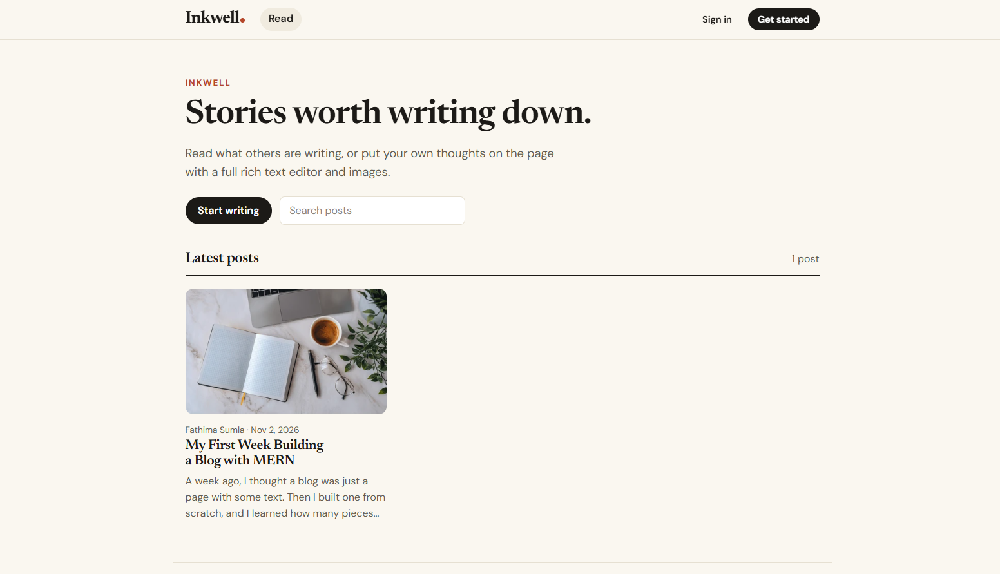
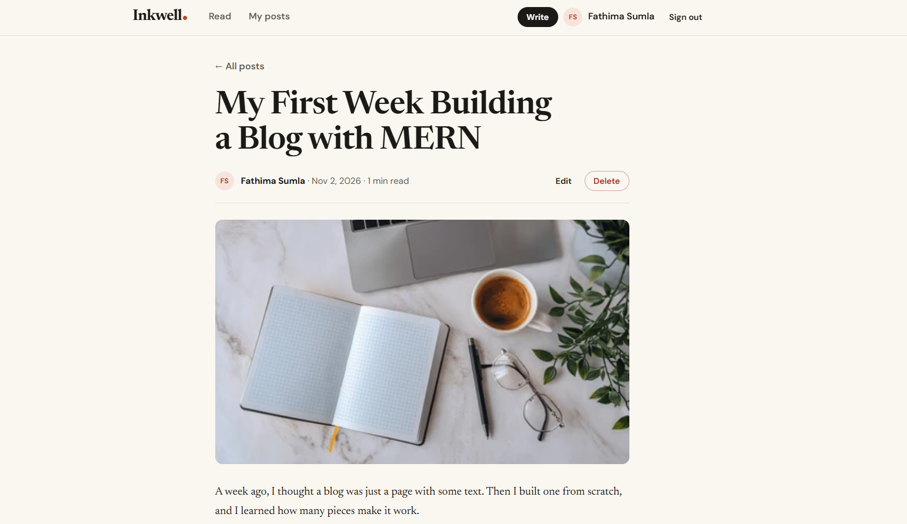
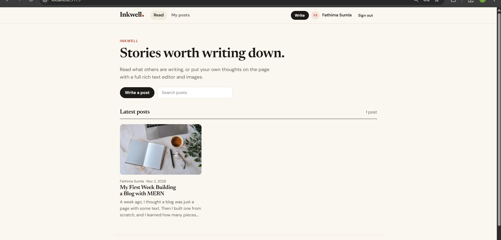
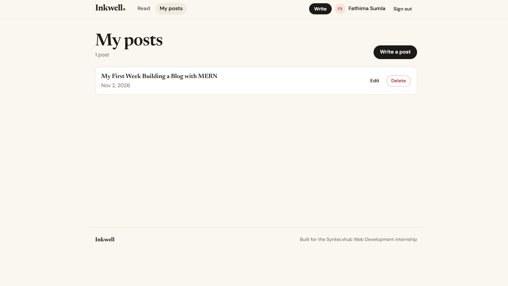
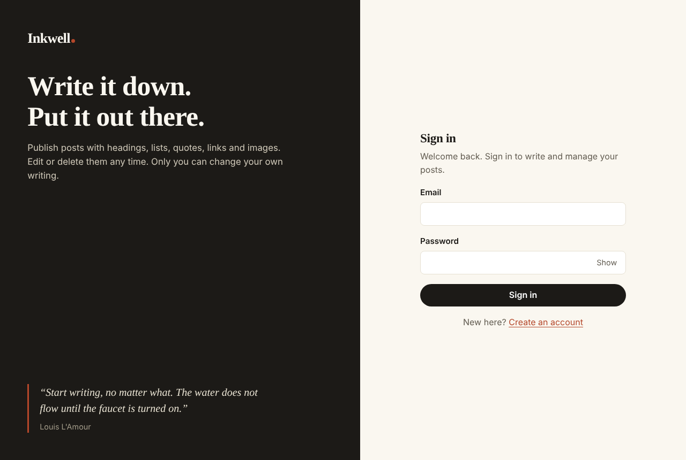

# Syntecxhub Blog Application (Inkwell)

A full-stack MERN blog built for the **Syntecxhub Web Development Internship (Task 4, Project 2)**.
Anyone can read posts. Signed-in users write posts in a rich text editor, upload images, and edit or delete **only their own** posts.

**Live app:** _add your frontend URL here_
**Live API:** _add your backend URL here_

## Features

- Register and sign in with JWT. Passwords are hashed with bcrypt.
- Rich text editor (Tiptap): bold, italic, underline, headings, lists, quotes, code, links and images.
- Image upload for a cover picture and for images inside the post body (JPG, PNG, GIF or WebP, up to 2 MB).
- Create, read, update and delete posts. Edit and delete are author-only (the API returns 403 for anyone else).
- Public home page with search and pagination, a post page with reading time, and a "My posts" dashboard.
- Responsive layout, protected routes, validation and clear JSON errors.

## Security notes

- **HTML is sanitised on the server** with `sanitize-html` using a whitelist of tags, so pasted `<script>` tags, `onerror=` handlers and `javascript:` links never reach the database or other readers.
- **Image checks:** the server reads the file's real bytes to confirm it is a JPG, PNG, GIF or WebP. SVG is rejected because it can carry scripts. Uploads are rate limited.
- helmet, CORS, rate limiting and JWT-protected write routes.

## Tech stack

| Part | Tools |
|---|---|
| Frontend | React 19, Vite, React Router, Tiptap editor, plain CSS |
| Backend | Node.js, Express 5, Mongoose |
| Database | MongoDB Atlas (posts, users and uploaded images) |
| Auth | JWT (Bearer token), bcryptjs |
| Extras | multer, sanitize-html, helmet, cors, morgan, express-rate-limit |

## Screenshots

| Home | Post |
|---|---|
|  |  |

| Editor | My posts |
|---|---|
|  |  |

| Sign in | Mobile |
|---|---|
|  |  |

## API endpoints

| Method | Endpoint | Auth | What it does |
|---|---|---|---|
| POST | `/api/auth/register` | public | Create an account, returns a token |
| POST | `/api/auth/login` | public | Sign in, returns a token |
| GET | `/api/auth/me` | token | Current user |
| GET | `/api/posts` | public | List posts. Query: `search`, `author`, `page`, `limit` |
| GET | `/api/posts/:id` | public | One post with full content |
| POST | `/api/posts` | token | Create a post |
| PUT | `/api/posts/:id` | author only | Update a post |
| DELETE | `/api/posts/:id` | author only | Delete a post |
| POST | `/api/images` | token | Upload an image (form field `image`), returns `{ id, url }` |
| GET | `/api/images/:id` | public | Serve an uploaded image |
| GET | `/api/health` | public | Health check |

Post fields: `title` (3 to 150 characters), `content` (HTML from the editor, required), `coverImage` (optional image URL).
Errors come back as `{ "message": "..." }`: 400 validation, 401 not signed in, 403 not the author, 404 not found, 409 email already used, 429 too many requests.

## Run it locally

You need Node.js 20+ and a MongoDB Atlas connection string.

```bash
# 1. Backend
cd server
npm install
cp .env.example .env      # then fill in MONGO_URI and JWT_SECRET
npm run dev               # http://localhost:5000

# 2. Frontend (new terminal)
cd client
npm install
cp .env.example .env      # VITE_API_URL=http://localhost:5000
npm run dev               # http://localhost:5173
```

## Test the API with Postman

Import `postman/Blog_API.postman_collection.json` and run the requests in order. Login saves the token and Create post saves the post id. For "Upload image", open Body, choose the `image` field and select a small JPG or PNG.

## Deploy (Vercel)

Create two Vercel projects from this repo.

1. **API:** Root Directory `server`. Add `MONGO_URI`, `JWT_SECRET`, `JWT_EXPIRES_IN`. In Atlas, allow `0.0.0.0/0` under Network Access.
2. **Frontend:** Root Directory `client`. Add `VITE_API_URL` set to the API URL (no trailing slash).

## Project structure

```
server/
  config/db.js              cached MongoDB connection
  models/                   User, Post, Image
  controllers/              auth, post and image logic
  middleware/               JWT protect, upload, errors, rate limiting
  routes/                   auth, post and image routes
  utils/html.js             HTML sanitising and excerpts
  server.js
client/
  src/pages/                Home, PostPage, Editor, MyPosts, AuthPage
  src/components/           Navbar, RichEditor, PostCard, ...
  src/context/              auth state
  src/api.js                API helper
postman/                    Postman collection
screenshots/
```

## Author

MM Fathima Sumla, Syntecxhub Web Development Internship.
